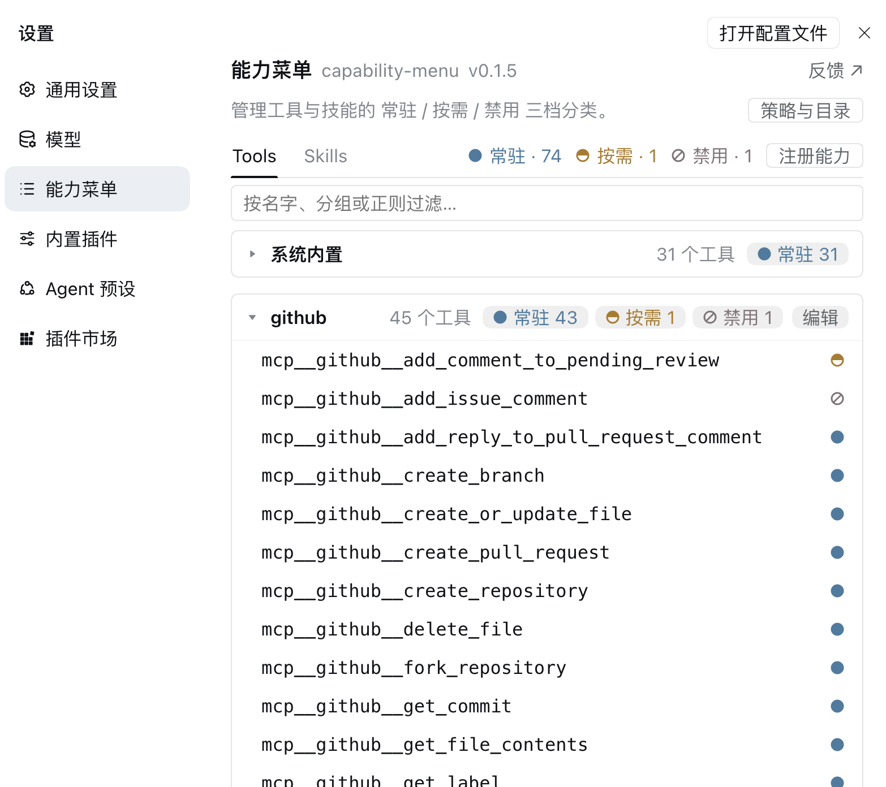
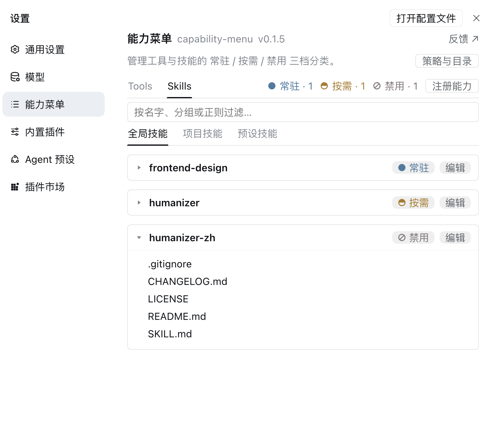

<h1 align="center">dsh-capability-menu</h1>

<p align="center">
  <strong>Manage how Tools and Skills are exposed and invoked in DeepSeek Harness, reducing context use through on-demand discovery</strong>
</p>

<p align="center">
  <a href="https://github.com/deepseek-ai/deepseek-harness"></a>
  <a href="https://www.npmjs.com/package/@daweifu/capability-menu"></a>
  <a href="https://github.com/PKUfudawei/dsh-capability-menu/actions"></a>
  <a href="https://www.npmjs.com/package/@daweifu/capability-menu"></a>
  <a href="https://github.com/PKUfudawei/dsh-capability-menu"></a>
  <a href="https://github.com/awesome-dsh-plugin/awesome-dsh-plugin"></a>
</p>

<p align="center">
  <a href="./README.md">简体中文</a> · <strong>English</strong>
</p>

## Table of Contents

- [Capability Overview](#capability-overview)
  - [Capability Model](#capability-model)
  - [Capability Menu](#capability-menu)
- [Installation and Uninstallation](#installation-and-uninstallation)
  - [Install from npm (recommended)](#install-from-npm-recommended)
  - [Install from source](#install-from-source)
  - [Verify the install](#verify-the-install)
  - [Uninstall](#uninstall)
- [Exposure Policy](#exposure-policy)
  - [Tools and Skills three-tier exposure and execution](#tools-and-skills-three-tier-exposure-and-execution)
- [Configuration](#configuration)
  - [All configuration options](#all-configuration-options)
  - [On-demand search catalog (`catalogFile`)](#on-demand-search-catalog-catalogfile)

---

## Capability Overview

- Builds a unified capability catalog (`ctx.capability`) for DeepSeek Harness tools (including MCP and built-in tools) and skills.
- Provides three policy tiers — **Resident / On-demand / Disabled** — to manage capability exposure and invocation.
- Supplies on-demand capabilities only when needed, reducing the tool definitions sent with each request and saving tokens and context.

### Capability Model

*Capability* is the umbrella concept introduced by this plugin: a Tool and a Skill are different *kinds* of capability.

| kind | provides to the agent | action | notes |
| --- | --- | --- | --- |
| `tool` | executes an action (an MCP tool or a harness-native built-in tool) | `execute` | indexed by `ctx.tools` |
| `skill` | the method / flow / knowledge for a class of tasks | `load` | indexed by `ctx.skills` |

The model gets two meta tools:

| tool | role | corresponding entry |
| --- | --- | --- |
| `meta_search` | Search capabilities visible to the current session; list mode supports offset pagination and reports total, returned, and has-more values; detail returns descriptions and tool schemas | `@daweifu/capability-menu/search` |
| `meta_invoke` | Unified execution surface for Tools and Skills; pass `force: true` to reload updated Skill instructions | `@daweifu/capability-menu/invoke` |

### Capability Menu

<p align="center">
  
  
</p>
After installation, open **Settings** and select **Capability Menu** from the settings navigation to manage Tools and Skills.

| Task | How to do it |
| --- | --- |
| Change a tier | Click the dot beside a capability. Click a tier count at the top to change the whole group. |
| Find a capability | Use the filter below the tabs to search by name or group. Regex is supported and matching is case-insensitive. |
| View details | Click a Tool to see its definition. Click a Skill to expand its files and preview them; content is rendered as Markdown. |
| Register a capability | Click **Register** in the top right to add an MCP server or Skill directory; Skills accept local paths or public GitHub URLs. |
| Edit or remove | Click **Edit** on a server group in Tools or a Skill row in Skills. |
| View rules and catalog | Click **Policy &amp; catalog** on the right side of the page header. The catalog tab also sets the search description limit. |
| Edit search description | Set a Tool or Skill to **On-demand**, then click **Search description** beside it to edit a short version of the provider description. |

MCP tool rows omit the repeated `mcp__server__` display prefix inside their server group. Hover to see the full name; search and invocation still use the full ID.

Registering an MCP server writes its patch configuration; a missing file or parent directory is created automatically. MCP credentials such as request headers are stored in the config; keep it secure. Skill registration creates a link or imports a directory into the selected skill root.

GitHub Skill imports accept a default-branch root URL (the root must contain `SKILL.md`), a specific branch root `https://github.com/{owner}/{repo}/tree/{branch}`, or a Skill subdirectory `https://github.com/{owner}/{repo}/tree/{branch}/{skill-directory}`. Local paths are also supported. Only public repositories are supported; Git must be installed on the machine running dsh. The plugin validates `SKILL.md` and copies only the selected directory.

## Installation and Uninstallation

Prerequisites: [Node.js](https://nodejs.org/en/download) and the [dsh CLI](https://github.com/deepseek-ai/deepseek-harness). Installing from npm needs no separate pnpm install; installing from source requires pnpm.

### Install from npm (recommended)

A single package ships both the server-side plugin and the front-end Capability Menu page; after installation it appears as its own section in Settings:

```sh
# install
dsh plugin --profile web add @daweifu/capability-menu

# upgrade to the version tagged latest on npm (name the version to avoid keeping the installed one)
dsh plugin --profile web add "@daweifu/capability-menu@$(npm view @daweifu/capability-menu dist-tags.latest)"

# To install a prerelease tag such as next, use that tag instead:
# dsh plugin --profile web add "@daweifu/capability-menu@$(npm view @daweifu/capability-menu dist-tags.next)"
```

The upgrade command installs the version pointed to by npm's `latest` tag; use the matching tag or an explicit version for prereleases.
The Capability Menu page checks npm `latest` automatically and shows **New version** beside its version when a higher release is available. Click to confirm an exact update for npm registry installs, including those managed by pnpm. For a local source link, the dialog offers manual source update steps or an explicit switch to the npm release without deleting the source directory. Restart DSH after installing.

### Install from source

```sh
git clone https://github.com/PKUfudawei/dsh-capability-menu.git
cd dsh-capability-menu
pnpm install                   # the prepare script builds lib/ (server) and lib/client.js (front-end)

dsh plugin --profile web add .
```

### Verify the install

```sh
cd "${DSH_HOME:-$HOME/.dsh}/profiles/web" && pnpm list @daweifu/capability-menu && dsh --profile web --dump-config | grep -m1 '== @daweifu/capability-menu'
```

### Uninstall

```sh
dsh plugin --profile web remove @daweifu/capability-menu
```

## Exposure Policy

All capabilities (Tool and Skill) fall into three tiers by their **exposure level** (what the model sees in the context) and their **execution mode**:

### Tools and Skills three-tier exposure and execution

| tier | capability | what the model sees | how to find it | how to use it |
| --- | --- | --- | --- | --- |
| **Resident** | tool | Tool definition is included with every request | No search needed | Call directly; it goes through the full `ctx.tools` pipeline |
| | skill | Name and summary appear in `<available_skills>` | No search needed | The `skill` tool loads the content when needed |
| **On-demand** | tool | Tool definition is not included with requests | Search candidates with `meta_search` or search the capability catalog YAML (`catalogFile`) | Call with `meta_invoke`, or fetch details and parameters by exact id before calling directly |
| | skill | Not shown in `<available_skills>` | Search with `meta_search` or search the capability catalog YAML (`catalogFile`) | Load `SKILL.md` with `meta_invoke` |
| **Disabled** | tool | Tool definition is not included with requests | Hidden from search results and the capability catalog | Calls are rejected |
| | skill | Not shown in `<available_skills>` | Hidden from search results and the capability catalog | Loads are rejected |

> **Scope & reserved tools**:
> - Tiers apply to MCP and harness-native built-in tools; built-ins use the reserved `built-in` group. **Do not name an MCP server `built-in`.**
> - `meta_search` and `meta_invoke` are always Resident and cannot be disabled. `run_code` is reserved for Code Mode; it is excluded from the catalog and menu and needs no tier rule.
> - **Keep high-frequency core tools Resident**: On-demand built-ins require `meta_search` → `meta_invoke` to use.

## Configuration

Hand-written rules live under `config` in this plugin's `capability-menu-policy` entry:

- The default file is `~/.dsh/cordis.patch.yml`; when `$DSH_HOME` is set, the file is `$DSH_HOME/cordis.patch.yml`.
- Edit the YAML directly or use Capability Menu. UI clicks update memory immediately and write to a separate `capability-menu-policy.json` about 1.5 seconds after input stops, without triggering a plugin reload. Existing patch rules still load; UI moves override exact rules for the same capability, while Disabled wildcards retain their priority.
- A profile can override the rules in its own `cordis.patch.yml`, targeting the entry ID. In examples, `- insert:`, `id`, and `name` are Cordis patch structure, not policy fields.
- The state file defaults to the directory containing `patchFile`, so UI moves are shared across profiles by default. Set a different `stateFile` in each profile's policy config to isolate them.
- Tier rules written to the patch by earlier versions remain active as base rules. To discard UI overrides and use the hand-written rules again, stop dsh and delete the state file.

```yaml
config:
  tools:
    resident: # Resident
      - execute_cmd
      - get_session_context
      - search_kb
      - 'mcp__gongfeng__*'    # wildcard: everything under this server is resident
    on-demand: # On-demand
      - 'mcp__*'              # wildcard fallback
      - 'server:km:*'         # bulk on-demand by server prefix
    disabled: # Disabled
      - 'mcp__secret__*'      # disabled outranks everything, even resident
  skills:
    resident: # Resident
      - debugging
      - coding
    on-demand: # On-demand
      - legacy_skill          # explicit on-demand (unlisted skills default to resident)
    disabled: # Disabled
      - forbidden_skill
  metaTools:
    - meta_search             # always resident; cannot be disabled
    - meta_invoke
```

### All configuration options

| Option | Entry | Default | Description |
| --- | --- | --- | --- |
| `tools` / `skills` / `metaTools` | `capability-menu-policy` | see above | Base tier rules in the patch; UI moves are saved separately |
| `catalogFile` | `capability-menu-registry` | `${DSH_HOME:-~/.dsh}/capability-catalog.yaml` | Materialized on-demand catalog path; empty disables it |
| `searchMetadataFile` | `capability-menu-registry` | `${DSH_HOME:-~/.dsh}/capability-menu-search-metadata.json` | Saved search descriptions and UI limit setting; empty prevents saving changes |
| `summaryMaxChars` | `capability-menu-registry` | `320` | Initial character limit for search descriptions, `meta_search` list summaries, and catalog descriptions; minimum 20; a UI-saved value takes precedence |
| `refreshDebounceMs` | `capability-menu-registry` | `200` | Debounce window (ms) for change-event rebuilds; `0` disables debouncing |
| `patchFile` | `capability-menu-policy` | `~/.dsh/cordis.patch.yml` (`$DSH_HOME` wins) | Patch file that MCP server registration writes to |
| `stateFile` | `capability-menu-policy` | `capability-menu-policy.json` beside `patchFile` | UI tier state; set to an empty string to disable persistence |
| `skillsDir` | `capability-menu-policy` | `~/.dsh/skills` | Skill root used by skill directory registration |
| `persistDebounceMs` | `capability-menu-policy` | `1500` | Debounce window (ms) before a clicked tier change is written to the state file |

These settings belong to their respective plugin entries and usually live in the same `cordis.patch.yml`. The plugin creates `stateFile` and `searchMetadataFile` automatically. `catalogFile` is the generated catalog for model-side search, while `skillsDir` is a directory for Skills.

**Rule priority** (evaluated in order: Disabled always wins; between Resident and On-demand, exact rules beat wildcards):

| priority | rule | example | effect |
| --- | --- | --- | --- |
| 1 | `disabled` exact | `disabled: [forbidden_skill]` | hardest deny, overrides everything |
| 2 | `disabled` wildcard | `disabled: ['mcp__secret__*']` | block a whole group |
| 3 | `resident` exact | `resident: [bash]` | keep one capability resident |
| 4 | `on-demand` exact | `on-demand: [legacy_skill]` | one capability on-demand (what a Capability Menu click writes) |
| 5 | `resident` wildcard | `resident: ['mcp__gongfeng__*']` | keep a whole group resident |
| 6 | `on-demand` wildcard | `on-demand: ['mcp__*']` | bulk on-demand fallback |
| default | no rule matched | — | resident |

If a higher-priority rule overrides a selected tier, the UI reports that the classification did not apply.

### On-demand search catalog (`catalogFile`)

The plugin writes On-demand Tools and Skills to the YAML file specified by `catalogFile` so the model can search them. The default is `${DSH_HOME:-~/.dsh}/capability-catalog.yaml`; set it to an empty string to disable the catalog. The catalog is updated when Tools, Skills, tiers, or search information change. When empty, it contains only `capabilities: []`.

On-demand capability rows show a **Search description** button. The editor starts with the description currently used by the catalog, shortened from the provider description to `summaryMaxChars` characters (320 by default). Truncation prefers a word or punctuation boundary. Changes are saved in `searchMetadataFile` and affect `meta_search` list results and keyword matching as well as the generated catalog. The provider definition and exact detail stay unchanged. **Restore** puts the provider text back into the editor; **Save** applies it. Direct edits to the generated YAML will be overwritten. Legacy `summary` values are read as search descriptions; custom tags stop affecting search. The old state file is backed up as `.legacy.bak` before its first rewrite.

The global **Search description limit** is editable at the top of **Policy & catalog → On-demand search catalog** (minimum 20 characters). Saving rebuilds the catalog immediately without editing the patch or reloading the plugin. The value is saved as `_settings.summaryMaxChars` in `searchMetadataFile` and takes precedence over the patch configuration on later starts. If an existing custom description exceeds a proposed lower limit, saving asks you to shorten that description first; it never discards it.

A Skill must be registered in `ctx.skills` to appear in the catalog. The model can search it with `grep` / `read` or call `meta_search`, then use the capability with `meta_invoke`. List mode returns up to 20 items by default (50 maximum per page); use `offset: 50` for the next page. `total` counts matches after scope and Disabled filtering; `returned` counts the current page. Skill details contain metadata and usage guidance; `meta_invoke` loads the body. Pass `force: true` to reload instructions changed during the session.

```yaml
# ~/.dsh/capability-catalog.yaml (auto-generated; contains only On-demand
# capabilities — Resident ones are already resident and Disabled ones must not
# be discoverable, so neither is written. Lists are emitted as `-` block
# sequences, one item per line.)
capabilities:
  - id: mcp__km__search
    kind: tool
    description: Search the knowledge base
    server: km
  - id: legacy_skill
    kind: skill
    description: A low-frequency skill for working on legacy code
    whenToUse: Use when working on legacy projects
```

The default follows `DSH_HOME`, and the plugin creates its parent directory. The management panel shows the catalog path. Multiple DSH instances share the default file; use a different path for each instance when they need separate catalogs.

## License

This project is licensed under the [Apache License 2.0](LICENSE).
