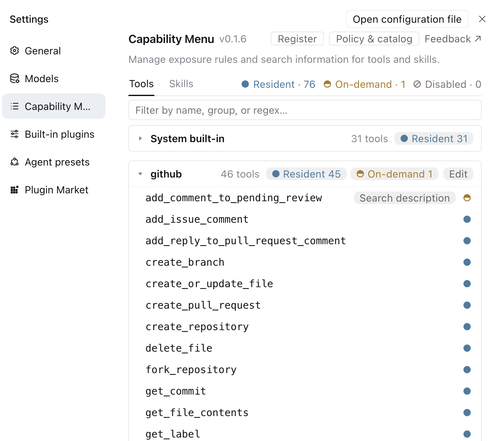
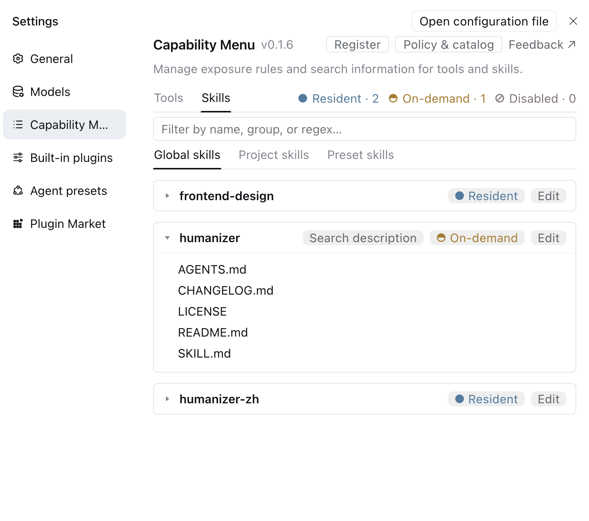

<h1 align="center">dsh-capability-menu</h1>

<p align="center">
  <strong>Manage DeepSeek Harness tools and skills, search efficiently, invoke on demand, and save context</strong>
</p>

<p align="center">
  <a href="https://github.com/deepseek-ai/deepseek-harness"></a>
  <a href="https://www.npmjs.com/package/@daweifu/capability-menu"></a>
  <a href="https://github.com/PKUfudawei/dsh-capability-menu/actions"></a>
  <a href="https://www.npmjs.com/package/@daweifu/capability-menu"></a>
  <a href="https://github.com/PKUfudawei/dsh-capability-menu"></a>
  <a href="https://github.com/awesome-dsh-plugin/awesome-dsh-plugin"></a>
</p>

<p align="center">
  <a href="./README.md">简体中文</a> · <strong>English</strong>
</p>

## Table of Contents

- [Capability Overview](#capability-overview)
  - [Capability Model](#capability-model)
  - [Capability Menu](#capability-menu)
- [Installation and Uninstallation](#installation-and-uninstallation)
  - [Install from npm (recommended)](#install-from-npm-recommended)
  - [Install from source](#install-from-source)
  - [Verify the install](#verify-the-install)
  - [Uninstall](#uninstall)
- [Policy & catalog](#policy--catalog)
  - [Exposure rules](#exposure-rules)
  - [On-demand search catalog](#on-demand-search-catalog)

---

## Capability Overview

- Builds a unified capability catalog (`ctx.capability`) for DeepSeek Harness tools (including MCP and built-in tools) and skills.
- Provides three policy tiers — **Resident / On-demand / Disabled** — to manage capability exposure and invocation.
- Supplies on-demand capabilities only when needed, reducing the tool definitions sent with each request and saving tokens and context.

### Capability Model

*Capability* is the umbrella concept introduced by this plugin: a Tool and a Skill are different *kinds* of capability.

| kind | provides to the agent | action | notes |
| --- | --- | --- | --- |
| `tool` | executes an action (an MCP tool or a harness-native built-in tool) | `execute` | indexed by `ctx.tools` |
| `skill` | the method / flow / knowledge for a class of tasks | `load` | indexed by `ctx.skills` |

The model gets two meta tools:

| tool | role | corresponding entry |
| --- | --- | --- |
| `meta_search` | Search On-demand capabilities available to the current session; list mode reports total, returned, and whether results were truncated; detail returns descriptions and tool schemas | `@daweifu/capability-menu/search` |
| `meta_invoke` | Unified execution surface for Tools and Skills; pass `force: true` to reload updated Skill instructions | `@daweifu/capability-menu/invoke` |

### Capability Menu

<p align="center">
  
  
</p>

After installation, open **Settings** and select **Capability Menu** from the settings navigation to manage Tools and Skills.

| Task | How to do it |
| --- | --- |
| Change a tier | Click the dot beside a capability. Click a tier count at the top to change the whole group. |
| Find a capability | Use the filter below the tabs to search by name or group. Regex is supported and matching is case-insensitive. |
| View details | Click a Tool to see its definition. Click a Skill to expand its files and preview them; content is rendered as Markdown. |
| Register a capability | Click **Register** in the top right to add an MCP server or Skill directory; Skills accept local paths or public GitHub URLs. |
| Edit or remove | Click **Edit** on a server group in Tools or a Skill row in Skills. |
| View rules and on-demand catalog | Click **Policy &amp; catalog** on the right side of the page header. The catalog tab also sets the search description limit. |
| Edit search description | Set a Tool or Skill to **On-demand**, then click **Search description** beside it to edit a short version of the provider description. |

Notes:

- **MCP names**: Server groups omit the `mcp__server__` prefix. Hover for the full name; search and invocation still use the full ID.
- **Registration**: MCP servers write to the patch config (missing files and directories are created). Request headers and other credentials are stored there; keep it secure. Skills are linked or imported into the selected skill root.
- **GitHub Skills**: Public repositories support a default-branch root (with `SKILL.md`), a branch root `.../tree/{branch}`, or a Skill directory `.../tree/{branch}/{skill-directory}`. Local paths also work. Git is required on the machine running dsh; the plugin validates `SKILL.md` and copies only the selected directory.

## Installation and Uninstallation

Prerequisites: [Node.js](https://nodejs.org/en/download) and the [dsh CLI](https://github.com/deepseek-ai/deepseek-harness). Installing from npm needs no separate pnpm install; installing from source requires pnpm.

Currently targets DSH `0.2.1-rc.3`.

### Install from npm (recommended)

```sh
dsh plugin --profile web add @daweifu/capability-menu
```

### Install from source

```sh
git clone https://github.com/PKUfudawei/dsh-capability-menu.git
cd dsh-capability-menu
pnpm install

dsh plugin --profile web add .
```

### Verify the install

```sh
cd "${DSH_HOME:-$HOME/.dsh}/profiles/web" && pnpm list @daweifu/capability-menu && dsh --profile web --dump-config | grep -m1 '== @daweifu/capability-menu'
```

### Uninstall

```sh
dsh plugin --profile web remove @daweifu/capability-menu
```

## Policy & catalog

This chapter follows the **Policy & catalog** dialog in Capability Menu.

### Exposure rules

All capabilities (Tool and Skill) fall into three tiers by their **exposure level** (what the model sees in the context) and their **execution mode**:

| tier | capability | what the model sees | how to find it | how to use it |
| --- | --- | --- | --- | --- |
| **Resident** | tool | Tool definition is included with every request | No search needed | Call directly; it goes through the full `ctx.tools` pipeline |
| | skill | Name and summary appear in `<available_skills>` | No search needed | The `skill` tool loads the content when needed |
| **On-demand** | tool | Tool definition is not included with requests | Search candidates with `meta_search` | Inspect parameters by exact ID, then call with `meta_invoke` |
| | skill | Not shown in `<available_skills>` | Search with `meta_search` | Load `SKILL.md` with `meta_invoke` |
| **Disabled** | tool | Tool definition is not included with requests | Hidden from `meta_search` | Calls are rejected |
| | skill | Not shown in `<available_skills>` | Hidden from `meta_search` | Loads are rejected |

Scope and exceptions:

- MCP tools and cataloged DSH native tools support all three tiers; native tools appear in the `built-in` group. Do not name an MCP server `built-in`, which would collide with that group.
- `meta_search` and `meta_invoke` are Resident by default and cannot be disabled in the menu. Code Mode's entry tool `run_code` does not appear in this plugin's catalog or menu; handwritten wildcard rules can still match it, so do not set it to On-demand or Disabled.
- Keep frequently used tools Resident; use `meta_search` to find an On-demand tool's ID and inspect its schema before invocation.

#### Rule configuration and persistence

The dialog shows effective rules composed from hand-written rules and menu choices; it is not another YAML file. Hand-written rules belong under `config` in the `capability-menu-policy` entry. This is a config fragment; see [cordis.patch.yml](./cordis.patch.yml) for the complete installation patch.

- The default patch is `${DSH_HOME:-~/.dsh}/cordis.patch.yml`. A profile can override the entry in its own patch.
- Tier changes in Capability Menu apply immediately and are written to `stateFile` about 1.5 seconds after input stops; search descriptions and their length limit are stored there too. These writes do not trigger DSH config reloads. Patch rules remain the base; UI choices override exact rules for the same capability, while Disabled wildcards still take priority.
- `stateFile` defaults to `${DSH_HOME:-~/.dsh}/capability-menu-policy.json` (beside the default patch), so profiles share UI choices. To isolate profiles, set the same custom `stateFile` in both the policy and registry entries. To clear UI choices, stop DSH and delete the state file; patch rules remain in effect.

```yaml
config:
  tools:
    on-demand: # On-demand
      - 'mcp__example__*'    # tools from one MCP server
    disabled: # Disabled
      - 'mcp__secret__*'
  skills:
    on-demand: # On-demand
      - example_skill        # unlisted capabilities default to Resident
```

Usually, you only need `tools` and `skills`. The optional file paths and debounce settings can keep their defaults. For every parameter, see the [policy config](./src/policy.ts) and [registry config](./src/registry.ts).

**Rule priority:** Rules are checked in order; Disabled takes precedence. Between Resident and On-demand, exact rules beat wildcards; at the same specificity, Resident wins. Capabilities matching no rule are Resident.

| priority | rule | example |
| --- | --- | --- |
| 1 | `disabled` exact or wildcard | `disabled: [forbidden_skill, 'mcp__secret__*']` |
| 2 | `resident` exact | `resident: [bash]` |
| 3 | `on-demand` exact | `on-demand: [example_skill]` |
| 4 | `resident` wildcard | `resident: ['mcp__gongfeng__*']` |
| 5 | `on-demand` wildcard | `on-demand: ['mcp__*']` |
| default | no rule matched | — |

Selecting a tier in Capability Menu writes an exact rule. If a higher-priority rule overrides the selected tier, the UI reports that the classification did not apply.

### On-demand search catalog

`meta_search` is the Agent's only search entry for On-demand Tools and Skills. **Policy & catalog → On-demand search catalog** shows summaries from the same in-memory index without generating a separate YAML file. Agent results are also filtered to capabilities available in the current session.

- **Search description:** By default, a Tool or Skill uses its provider description shortened to `summaryMaxChars` characters (320 by default); a Skill with no meaningful description falls back to `whenToUse`. Both `meta_search` lists and keyword matching use this summary. A saved custom description replaces it without changing the provider definition or exact detail. **Restore** resets the field, and **Save** applies it.
- **Description limit:** Set it in **Policy & catalog → On-demand search catalog** (minimum 20). The saved value in `stateFile` takes priority over `summaryMaxChars` in the patch. Shorten any custom descriptions above a proposed lower limit before saving.
- **Search and invoke:** Find matching candidates with `meta_search({query})`, inspect the full parameter schema with `meta_search({id, kind})`, then call or load one with `meta_invoke({id, kind, args})`. If no useful keyword is known, `meta_search({})` shows a limited overview. A call returns up to 20 entries by default; `max_results` can raise the limit to 100. Refine the query when results are truncated. A Skill must be registered in `ctx.skills`; pass `force: true` to reload one already read in this session.

## License

This project is licensed under the [Apache License 2.0](LICENSE).
