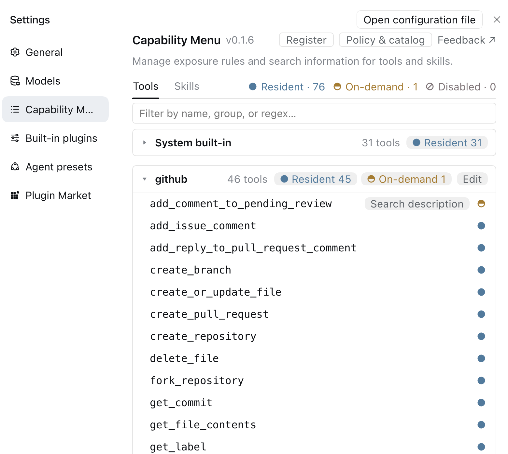
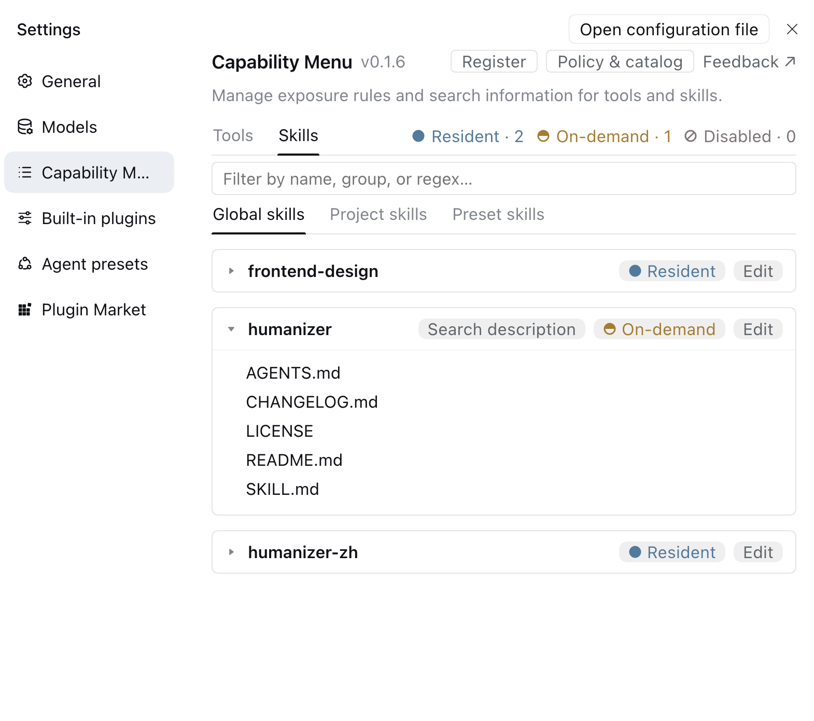

<h1 align="center">dsh-capability-menu</h1>

<p align="center">
  <strong>Manage DeepSeek Harness tools and skills, search efficiently, invoke on demand, and save context</strong>
</p>

<p align="center">
  <a href="https://www.npmjs.com/package/@deepseek-ai/dsh"></a>
  <a href="https://www.npmjs.com/package/@daweifu/capability-menu"></a>
  <a href="https://github.com/PKUfudawei/dsh-capability-menu/actions"></a>
  <a href="https://www.npmjs.com/package/@daweifu/capability-menu"></a>
  <a href="https://github.com/PKUfudawei/dsh-capability-menu"></a>
  <a href="https://github.com/awesome-dsh-plugin/awesome-dsh-plugin"></a>
</p>

<p align="center">
  <a href="./README.md">中文</a> · <strong>English</strong>
</p>

## Table of Contents

- [Capability Overview](#capability-overview)
  - [Capability Model](#capability-model)
  - [Capability Menu](#capability-menu)
- [Installation and Uninstallation](#installation-and-uninstallation)
  - [Install from npm (recommended)](#install-from-npm-recommended)
  - [Install from source](#install-from-source)
  - [Verify the install](#verify-the-install)
  - [Uninstall](#uninstall)
- [Policy & catalog](#policy--catalog)
  - [Exposure rules](#exposure-rules)
  - [On-demand search catalog](#on-demand-search-catalog)
- [Contributing](#contributing)

---

## Capability Overview

- Builds a unified capability catalog (`ctx.capability`) for DeepSeek Harness tools (including MCP and built-in tools) and skills.
- Provides three policy tiers — **Resident / On-demand / Disabled** — to manage capability exposure and invocation.
- Supplies on-demand capabilities only when needed, reducing the tool definitions sent with each request and saving tokens and context.

### Capability Model

*Capability* is the umbrella concept introduced by this plugin: a Tool and a Skill are different *kinds* of capability.

| kind | provides to the agent | action | notes |
| --- | --- | --- | --- |
| `tool` | executes an action (an MCP tool or a harness-native built-in tool) | `execute` | indexed by `ctx.tools` |
| `skill` | the method / flow / knowledge for a class of tasks | `load` | indexed by `ctx.skills` |

The model gets two meta tools:

| tool | role | corresponding entry |
| --- | --- | --- |
| `meta_search` | Search On-demand capabilities available to the current session; list mode reports total, returned, and whether results were truncated; detail returns descriptions and tool schemas | `@daweifu/capability-menu/search` |
| `meta_invoke` | Unified execution surface for Tools and Skills; pass `force: true` to reload updated Skill instructions | `@daweifu/capability-menu/invoke` |

### Capability Menu

<p align="center">
  
  
</p>

After installation, open **Settings** and select **Capability Menu** from the settings navigation to manage Tools and Skills.

Capability Menu follows the main conversation’s actual **mode (Agent preset)**, displaying a read-only current-mode label with DSH’s localized display name rather than an independent selector. Navigating to another conversation updates the panel; changing the new-session default does not change existing sessions. Until the session preset resolves, the panel waits and never writes global policy. Each mode saves its own Tools and Skills policy without inheriting global or other-mode settings. New modes start with Resident capabilities. Tools and Skills share tier buttons with immediate feedback and a 1.5-second debounced save. Pending changes remain bound to their original preset and flush on navigation; failures identify that preset and retain a retry action. Skill source tabs remain Global / Project / Mode skills, with fixed-label update controls on the right. Progress, results, and errors appear only in expanded details, without toolbar summaries or elapsed-time messages.

Click a group's tier-count button to cycle its displayed tools in that tier (for example, Resident to On-demand). With mixed tiers, each button changes only the tools in its own tier. Changes are saved individually in the current mode. It does not establish a server default or affect future tools. Meta tools remain Resident. Disabling tools does not disconnect shared MCP connections. Resource instructions retain the behavior documented below. Source installation, updates, and removal remain shared operations.

Changes apply to subsequent requests after saving, without interrupting running tools or rewriting conversation history. Each mode's policy is saved independently, and menu tier choices apply directly to the current mode. The native skill catalog is filtered before session commit and deduplicated against visible history, including policy-only changes. On-demand skills remain searchable through `meta_search`; Disabled policy also filters native `/skill-name` instruction injections.

| Task | How to do it |
| --- | --- |
| Change a tier | Click the capability's tier button to cycle its tier. The tier-count buttons beside a server cycle the currently displayed tools in the corresponding tier. |
| Find a capability | Use the filter below the tabs to search by name or group. Regex is supported and matching is case-insensitive. |
| View details | Click a Tool to see its definition. Click a Skill to expand its files and preview them; content is rendered as Markdown. |
| Register a capability | Click **Register** in the top right to add an MCP server or Skill directory; Skills accept local paths or public GitHub URLs. |
| Edit or remove | Click **Edit** on a server group in Tools or a Skill row in Skills. |
| View rules and on-demand catalog | Click **Policy &amp; catalog** on the right side of the page header. The catalog tab also sets the search description limit. |
| Edit search description | Set a Tool or Skill to **On-demand**, then click **Search description** beside it to edit a short version of the provider description. |

- **Startup state**: The menu mounts its remote interface in the background, shows a loading state until it is ready, and displays an error if mounting fails.

- **MCP names**: Server groups omit the `mcp__server__` prefix. Hover for the full name; search and invocation still use the full ID.
- **Registration**: MCP servers write to the patch config (missing files and directories are created). Request headers and other credentials are stored there; keep it secure. Skills are linked or imported into the selected skill root.
- **GitHub Skills**: Public repositories support a default-branch root (with `SKILL.md`), a branch root `.../tree/{branch}`, or a Skill directory `.../tree/{branch}/{skill-directory}`. Local paths also work. Git is required on the machine running dsh; the plugin validates `SKILL.md` and copies only the selected directory.
- **Skill updates:** Checks run only when you click **Check for updates** in Skills or retry a failed check. Opening the page, switching tabs, and leaving it open do not trigger checks. Checks run with up to three concurrent requests; one failure does not block other items. Details show per-item state and completed-count progress. Installation updates remain sequential. Checks respect the current search, including regular expressions, across global and project source tabs. With no filter, all manageable skills are checked. Details and batch updates use the same filter; other results are retained. After checking, you can view diffs and update one or several supported Skills. Checks cover only the Skill directory; commits elsewhere do not affect update status, and local edits prevent replacement. Skill names are plain text; commit hashes link to the latest GitHub commit affecting that directory. Up-to-date results show the last commit subject for that directory on one truncated line, with the full text on hover. If history is unavailable or exceeds the lookup depth, the subject is omitted rather than replaced with an unrelated repository commit. Local links can be checked read-only using the target Git repository or installer GitHub source records; unknown sources are reported explicitly. Ambiguous differences appear as “Content differs” without requiring a confirmation action. Update links through their original installation method. Mode-provided Skills do not support automatic updates.

- Skill directories can link to a matching GitHub version. Searches inspect up to 200 distinct directory versions within 60 seconds (excluding the initial checkout); reaching a limit is reported without saving a source. Sources can be edited or unlinked: failed validation preserves the existing source, and unlinking preserves Skill files. Directories containing `.git` support linking and checking but must be updated using Git; menu and batch updates exclude them. Content comparison excludes only root-level `.git` metadata.

## Installation and Uninstallation

Prerequisites: [Node.js](https://nodejs.org/en/download) `>=24.9.0` and an installed [DeepSeek Harness](https://github.com/deepseek-ai/deepseek-harness) with the `dsh` command available in your terminal. Installing from source also requires pnpm.

### Install from npm (recommended)

```sh
dsh plugin --profile web add @daweifu/capability-menu
```

### Install from source

```sh
git clone https://github.com/PKUfudawei/dsh-capability-menu.git
cd dsh-capability-menu
pnpm install

dsh plugin --profile web add .
```

### Verify the install

```sh
dsh --profile web --dump-config | grep -m1 '== @daweifu/capability-menu'
```

### Uninstall

```sh
dsh plugin --profile web remove @daweifu/capability-menu
```

## Policy & catalog

This chapter follows the **Policy & catalog** dialog in Capability Menu.

### Exposure rules

All capabilities (Tool and Skill) fall into three tiers by their **exposure level** (what the model sees in the context) and their **execution mode**:

| tier | capability | what the model sees | how to find it | how to use it |
| --- | --- | --- | --- | --- |
| **Resident** | tool | Tool definition is included with every request | No search needed | Call directly; it goes through the full `ctx.tools` pipeline |
| | skill | Name and summary appear in `<available_skills>` | No search needed | The `skill` tool loads the content when needed |
| **On-demand** | tool | Tool definition is not included with requests | Search candidates with `meta_search` | Inspect parameters by exact ID, then call with `meta_invoke` |
| | skill | Not shown in `<available_skills>` | Search with `meta_search` | Load `SKILL.md` with `meta_invoke` |
| **Disabled** | tool | Tool definition is not included with requests | Hidden from `meta_search` | Calls are rejected |
| | skill | Not shown in `<available_skills>` | Hidden from `meta_search` | Loads are rejected |

Scope and exceptions:

- MCP tools and cataloged DSH native tools support all three tiers; native tools appear in the `built-in` group. Do not name an MCP server `built-in`, which would collide with that group.
- When an MCP server has tools in the current scope and all of them are Disabled, its shared instructions (DSH's `mcp:<server>` section) are no longer injected automatically. Partial disabling removes the disabled tools' definitions but keeps shared instructions; On-demand tools also keep them. Re-enabling restores the instructions without disconnecting the server or deleting chat history. An empty tool inventory is not treated as all Disabled. If the host also contributes an MCP resource catalog and resource tools remain available, server instructions are conservatively retained because the host does not expose per-server resource instruction ownership.
- `meta_search` and `meta_invoke` remain Resident and cannot be disabled in the menu. Code Mode's entry tool `run_code` does not appear in this plugin's catalog or menu.
- Keep frequently used tools Resident; use `meta_search` to find an On-demand tool's ID and inspect its schema before invocation.

#### Rule configuration and persistence

The policy dialog lists the current mode's effective tool and skill tiers for inspection, not as a separate editable YAML file.

- Menu choices and search metadata are saved in `stateFile` without reloading DSH configuration.
- The default is `${DSH_HOME:-~/.dsh}/capability-menu-policy.json`, shared across profiles. Set the same custom `stateFile` on policy and registry entries to isolate a profile.
- Use the menu for routine changes. Deleting the state file discards every mode's policy and search descriptions.

### On-demand search catalog

`meta_search` is the Agent's only search entry for On-demand Tools and Skills. **Policy & catalog → On-demand search catalog** shows summaries from the same in-memory index without generating a separate YAML file. Agent results are also filtered to capabilities available in the current session.

- **Search description:** On-demand capabilities use a short provider description (up to 320 characters) by default; you can edit it in the menu. `meta_search` uses this summary for its list and keyword matching. Editing it does not change the provider definition.
- **Description limit:** Set it under **Policy & catalog → On-demand search catalog** (minimum 20 characters). Shorten custom descriptions that exceed a lower limit before saving it.
- **Search and invoke:** Use `meta_search({query})` to find a capability, `meta_search({id, kind})` to inspect its parameters, and `meta_invoke({id, kind, args})` to call or load it. Pass `force: true` to reload a Skill already loaded in the current session.

## Contributing

Bug reports, documentation fixes, and code contributions are welcome. See [CONTRIBUTING.md](./CONTRIBUTING.md) for the workflow and merge criteria. Issues and pull requests may be written in English or Chinese.

## License

This project is licensed under the [Apache License 2.0](LICENSE).
