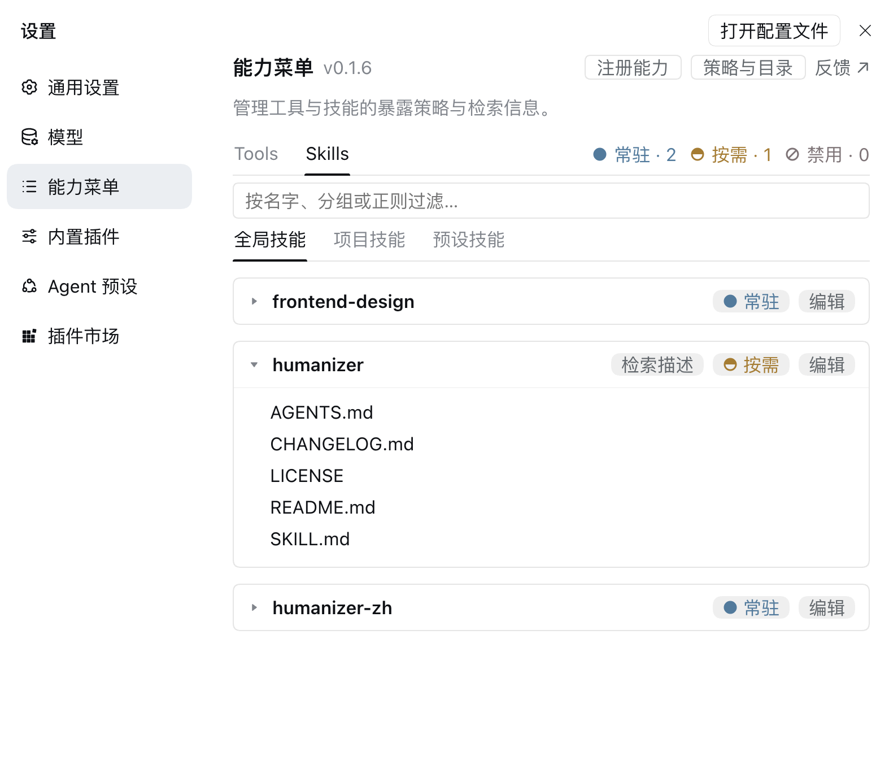

<h1 align="center">dsh-capability-menu</h1>

<p align="center">
  <strong>统一管理 DeepSeek Harness 工具与技能，高效检索、按需调用，节省上下文</strong>
</p>

<p align="center">
  <a href="https://www.npmjs.com/package/@deepseek-ai/dsh"></a>
  <a href="https://www.npmjs.com/package/@daweifu/capability-menu"></a>
  <a href="https://github.com/PKUfudawei/dsh-capability-menu/actions"></a>
  <a href="https://www.npmjs.com/package/@daweifu/capability-menu"></a>
  <a href="https://github.com/PKUfudawei/dsh-capability-menu"></a>
  <a href="https://github.com/awesome-dsh-plugin/awesome-dsh-plugin"></a>
</p>

<p align="center">
  <strong>中文</strong> · <a href="./README.en.md">English</a>
</p>

## 目录

- [能力总览](#能力总览)
  - [能力模型](#能力模型)
  - [能力菜单](#能力菜单)
- [安装与卸载](#安装与卸载)
  - [从 npm 安装（推荐）](#从-npm-安装推荐)
  - [从源码安装](#从源码安装)
  - [验证安装](#验证安装)
  - [卸载](#卸载)
- [策略与目录](#策略与目录)
  - [能力暴露规则](#能力暴露规则)
  - [按需检索目录](#按需检索目录)
- [参与贡献](#参与贡献)

---

## 能力总览

- 为 DeepSeek Harness 的 tools（包括 MCP 工具和内置工具）与 skills 建立统一能力目录：`ctx.capability`。
- 提供**常驻 / 按需 / 禁用**三档策略，管理能力的暴露与调用。
- 按需能力只在需要时提供给 Agent，减少单次请求携带的工具定义，节省 token 和上下文。

### 能力模型

Capability 是本插件引入的上位概念：Tool / Skill 是不同类型的 capability。

| kind | 对 Agent 提供 | action | 备注 |
| --- | --- | --- | --- |
| `tool` | 执行一个动作（MCP 工具或内置原生工具） | `execute` | 由 `ctx.tools` 索引 |
| `skill` | 某类任务的方法/流程/知识 | `load` | 由 `ctx.skills` 索引 |

模型获得两个元工具：

| 工具 | 作用 | 对应 entry |
| --- | --- | --- |
| `meta_search` | 搜索当前会话可用的按需能力；列表返回匹配总数、已返回数及是否截断，详情返回说明和工具参数 schema | `@daweifu/capability-menu/search` |
| `meta_invoke` | 统一执行面：Tool 真执行（走完整 `ctx.tools` 管线）+ Skill 加载；`force: true` 可重载已更新的 Skill | `@daweifu/capability-menu/invoke` |

### 能力菜单

<p align="center">
  
  
</p>

安装后，在「设置」导航中选择「能力菜单」，即可管理 Tools 和 Skills。

能力菜单自动跟随主会话实际使用的**模式（Agent preset）**，顶部只显示「当前模式」，名称沿用 DSH 的本地化显示名称，不提供独立切换或跨预设编辑。切换会话后随之更新；修改新会话默认预设不会改变已有会话。未取得明确会话预设时显示等待提示，不写入全局策略。每个模式独立保存 Tools 和 Skills 策略，不继承全局或其他模式。新模式的能力初始档位为常驻。Tools 与 Skills 使用相同的档位按钮，点击立即轮换，停止操作 1.5 秒后合并保存。待保存修改始终绑定原预设；切换后立即提交原队列，失败提示标明预设并保留重试，不会写入新预设。技能来源标签为「全局技能 / 项目技能 / 模式技能」；检查更新位于标签右侧，按钮文字固定；进度、结果和错误仅在展开的更新详情中展示，不在标签行显示汇总或等待秒数。

服务标题旁的档位计数按钮可点击轮换。例如点击「常驻 5」，会把本组当前显示的常驻工具一起切到按需；多种档位并存时，各按钮只切换对应档位的工具。修改逐项保存到当前模式，不设置服务默认值，也不影响今后新增工具。两个元工具始终常驻。工具禁用不会断开共享 MCP 连接；资源说明仍遵循下文的保守保留规则。能力来源的注册、更新和删除仍管理共享来源。

档位修改保存成功后对后续请求生效，不中断已运行的工具、不改写旧历史。首次加载升级状态文件到 v4：把已有模式的有效策略复制为独立配置，保留检索描述。旧服务规则及通配规则仅作为各模式自己的迁移快照保留，菜单中的新选择直接覆盖该能力的档位；修改全局配置不再影响这些模式。

DSH `0.2.2-rc.5` 的原生技能目录在消息落盘前按当前预设过滤并与可见历史去重；只改变档位也会发布必要的目录更新。按需技能仍可通过 `meta_search` 检索。禁用技能的原生 `/技能名` 正文注入同样受策略限制。

| 操作 | 用法 |
| --- | --- |
| 更改档位 | 点击能力旁的档位按钮轮换；服务标题旁的档位计数按钮轮换当前显示且属于该档位的工具 |
| 查找能力 | 使用页签下方的过滤框搜索名称或分组；支持正则表达式，不区分大小写 |
| 查看能力详情 | 点击 Tool 查看定义；点击 Skill 展开文件列表并预览文件，内容按 Markdown 渲染 |
| 注册能力 | 点击右上角「注册能力」，添加 MCP 服务器或 Skill 目录；Skill 支持本机目录或公开 GitHub 链接 |
| 编辑或移除 | 在 Tools 的服务器分组或 Skills 的技能项中点击「编辑」 |
| 查看规则和按需目录 | 点击页头右侧的「策略与目录」，查看生效规则及按需能力摘要；可在按需检索目录中调整描述上限 |
| 编辑检索描述 | 将 Tool 或 Skill 设为「按需」后，点击旁边的「检索描述」，在来源描述的简短版本上修改 |

- **启动状态**：能力菜单在后台挂载远程接口；接口就绪前显示加载状态，挂载失败时显示错误信息。

- **MCP 名称**：分组内省略 `mcp__服务器名__` 前缀；悬停可看全名，检索和调用仍用完整 ID。
- **注册位置**：MCP 写入 patch 配置（自动创建缺失的文件和目录）；请求头等凭据也保存在其中，请妥善保管。Skill 在所选技能根目录创建链接或导入目录。
- **GitHub Skill**：支持公开仓库的默认分支根目录（含 `SKILL.md`）、指定分支根目录 `.../tree/{branch}` 或其下的技能目录 `.../tree/{branch}/{skill-directory}`；也支持本机目录。导入需在运行 dsh 的机器上安装 Git；插件会校验 `SKILL.md`，只复制所选目录。
- **Skill 更新**：仅在点击 Skills 页的「检查更新」或检查失败后的「重试」时检查；打开页面、切换页签和停留期间均不会自动检查。检查最多同时运行 3 项，单项失败不阻塞其他项；详情按每项显示状态，并按完成数统计进度。实际安装更新仍逐项执行。检查范围遵循当前搜索（含正则表达式），覆盖匹配的全局和项目技能，不受来源标签限制；未筛选时检查全部可管理技能。详情和批量更新也遵循该筛选，其他技能的已有结果保留。检查后可查看差异，并单个或批量更新支持更新的技能。仅比较对应 Skill 目录，其他目录的提交不影响更新结果；本地修改会阻止覆盖。技能名不附链接；提交号链接直达该目录最近一次变更的 GitHub 提交页。「已是最新」旁显示该目录最近一次提交的说明，超出一行省略，悬停可查看全文。历史获取失败或超过查询深度时不显示说明，不用仓库其他提交代替。本地链接可通过目标 Git 仓库或安装器的 GitHub 来源记录进行只读检查；未知来源会明确提示，无法区分本地修改与上游更新时显示「内容有差异」；该提示不是确认操作。链接技能需通过原安装方式更新，模式技能不参与自动更新。

- 旧版普通目录可输入原 GitHub 链接关联当前或历史快照；历史搜索最多检查 200 个不同目录版本，限时 60 秒（不含初始检出），达到限制会明确提示，且不写入来源。支持修改或解除来源，验证失败保留旧来源，解除关联保留技能文件。含 `.git` 的目录可关联和检查，但需通过 Git 更新，不参与菜单单个或批量更新。内容比较仅排除技能根目录的 `.git` 元数据，不忽略其他本地文件。

## 安装与卸载

前置：[Node.js](https://nodejs.org/en/download)，以及已安装的 [DeepSeek Harness](https://github.com/deepseek-ai/deepseek-harness)（确保终端中可运行 `dsh` 命令）。DSH `0.2.2-rc.1` 要求 Node.js `>=24.9.0`。从 npm 安装无需单独安装 pnpm；从源码安装需要 pnpm。

插件 `0.1.9` 适配 DSH `0.2.2-rc.1`，支持 Tool 三档分层和 `meta_invoke` 转发。

### 从 npm 安装（推荐）

```sh
dsh plugin --profile web add @daweifu/capability-menu
```

### 从源码安装

```sh
git clone https://github.com/PKUfudawei/dsh-capability-menu.git
cd dsh-capability-menu
pnpm install

dsh plugin --profile web add .
```

### 验证安装

```sh
cd "${DSH_HOME:-$HOME/.dsh}/profiles/web" && pnpm list @daweifu/capability-menu && dsh --profile web --dump-config | grep -m1 '== @daweifu/capability-menu'
```

### 卸载

```sh
dsh plugin --profile web remove @daweifu/capability-menu
```

## 策略与目录

这一章对应能力菜单中的「策略与目录」弹窗。

### 能力暴露规则

所有能力（Tool 与 Skill）按 **暴露程度**（模型在上下文中看到什么）与 **执行方式** 分为三档：

| 档位 | 能力 | 模型能看到什么 | 如何找到 | 如何使用 |
| --- | --- | --- | --- | --- |
| **常驻** | tool | 工具定义始终随请求提供 | 无需查找 | 直接调用；运行时经过完整 `ctx.tools` 管线 |
| | skill | 名称和简介显示在 `<available_skills>` 中 | 无需查找 | `skill` 工具按需加载正文 |
| **按需** | tool | 不随请求提供工具定义 | 用 `meta_search` 搜索候选项 | 按精确 ID 查看参数后，用 `meta_invoke` 调用 |
| | skill | 不显示在 `<available_skills>` 中 | 用 `meta_search` 搜索 | 用 `meta_invoke` 加载 `SKILL.md` |
| **禁用** | tool | 不随请求提供工具定义 | `meta_search` 中不可见 | 调用会被拒绝 |
| | skill | 不显示在 `<available_skills>` 中 | `meta_search` 中不可见 | 加载会被拒绝 |

适用范围与例外：

- MCP 工具和可编目的 DSH 原生工具都支持三档；原生工具归入 `built-in` 分组。请勿将 MCP 服务器命名为 `built-in`，以免与该分组冲突。
- `meta_search` 和 `meta_invoke` 默认常驻，不能在菜单中禁用。DSH Code Mode 的入口 `run_code` 不进入本插件的目录或菜单；手写通配规则仍可能匹配它，请勿将其设为按需或禁用。
- 高频工具建议保持常驻；按需工具可通过 `meta_search` 找 ID、查看参数 schema，再调用。
- MCP 服务在当前作用域内有工具，且这些工具全部为「禁用」时，不再自动注入该服务的公共说明（DSH 的 `mcp:<服务器名>` 段落）。部分禁用时仍移除被禁用工具的定义，但保留公共说明；有按需工具时也保留说明。重新启用后自动恢复，不会断开服务连接或删除聊天历史。空工具列表不视为全部禁用。若宿主还提供 MCP 资源目录且资源工具仍可用，则保守保留服务说明，因为宿主目前未提供逐服务的资源说明归属接口。

#### 规则配置与保存

弹窗列出当前模式实际生效的工具和技能档位，供查看，不是另一份可编辑的 YAML 文件。

- 菜单档位、检索描述和描述上限保存在 `stateFile` 中，不触发 DSH 配置重载。
- `stateFile` 默认是 `${DSH_HOME:-~/.dsh}/capability-menu-policy.json`，各 Profile 共用；需要隔离时，在 policy 和 registry 两个 entry 中指定同一个 `stateFile`。
- 日常调整请使用能力菜单。下列手写配置仅用于旧版兼容和首次迁移；已有模式不持续读取它。删除状态文件会同时丢失模式策略及检索描述，并在下次启动时重新迁移，不是单个模式的重置操作。

旧配置示例（完整安装补丁见 [cordis.patch.yml](./cordis.patch.yml)）：

```yaml
config:
  tools:
    on-demand: # 按需
      - 'mcp__example__*'    # 某个 MCP 服务器下的工具
    disabled: # 禁用
      - 'mcp__secret__*'
  skills:
    on-demand: # 按需
      - example_skill        # 未列出的能力默认常驻
```

文件路径与防抖等可选项使用默认值即可；完整参数见 [policy 配置](./src/policy.ts) 和 [registry 配置](./src/registry.ts)。

**旧配置的规则优先级：** 按序匹配；禁用优先。在常驻与按需之间，精确规则优先于通配；同为精确或同为通配时，常驻优先。未命中任何规则则常驻。

| 优先级 | 规则 | 示例 |
| --- | --- | --- |
| 1 | `disabled` 精确或通配 | `disabled: [forbidden_skill, 'mcp__secret__*']` |
| 2 | `resident` 精确 | `resident: [bash]` |
| 3 | `on-demand` 精确 | `on-demand: [example_skill]` |
| 4 | `resident` 通配 | `resident: ['mcp__gongfeng__*']` |
| 5 | `on-demand` 通配 | `on-demand: ['mcp__*']` |
| 默认 | 未命中任何规则 | — |

以上规则优先级用于旧配置及迁移时的初始策略。能力菜单直接保存当前模式的单项档位，不再回退到全局配置；元工具始终常驻。

### 按需检索目录

`meta_search` 是 Agent 检索按需 Tool 和 Skill 的唯一入口。「策略与目录 → 按需检索目录」直接显示同一内存索引中的按需能力摘要，不生成单独的 YAML 文件。Agent 的检索结果还会按当前会话的可用范围过滤。

- **检索描述：** 按需能力默认使用来源描述的摘要（最多 320 字符），可在菜单中编辑。`meta_search` 的列表与关键词匹配使用该摘要；编辑不会修改来源定义。
- **描述上限：** 在「策略与目录 → 按需检索目录」设置，最小 20 字符。降低上限前需先缩短超限的自定义描述。
- **检索与调用：** 用 `meta_search({query})` 查找能力，再用 `meta_search({id, kind})` 查看参数，最后用 `meta_invoke({id, kind, args})` 调用或加载。已在当前会话加载的 Skill 可传 `force: true` 重新加载。

## 参与贡献

欢迎提交问题、文档修正和代码。贡献流程与合入标准见 [CONTRIBUTING.md](./CONTRIBUTING.md)；issue 和 PR 可以使用中文或英文。

## License

本项目遵循 [Apache License 2.0](LICENSE)。
