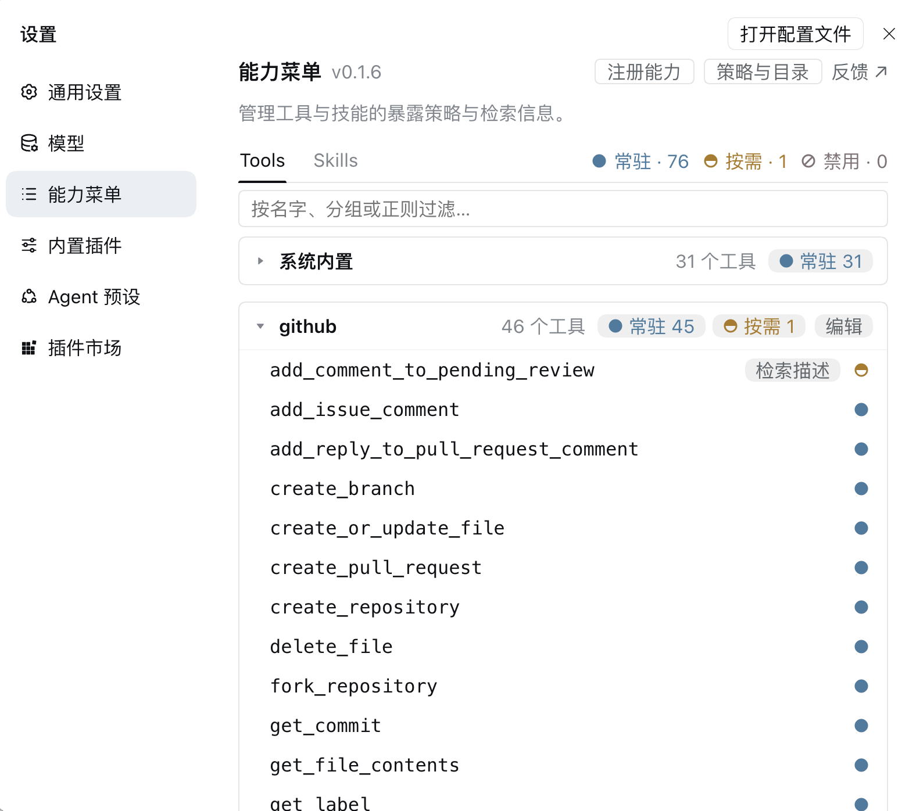

<h1 align="center">dsh-capability-menu</h1>

<p align="center">
  <strong>统一管理 DeepSeek Harness 工具与技能，高效检索、按需调用，节省上下文</strong>
</p>

<p align="center">
  <a href="https://www.npmjs.com/package/@deepseek-ai/dsh"></a>
  <a href="https://www.npmjs.com/package/@daweifu/capability-menu"></a>
  <a href="https://github.com/PKUfudawei/dsh-capability-menu/actions"></a>
  <a href="https://www.npmjs.com/package/@daweifu/capability-menu"></a>
  <a href="https://github.com/PKUfudawei/dsh-capability-menu"></a>
  <a href="https://github.com/awesome-dsh-plugin/awesome-dsh-plugin"></a>
</p>

<p align="center">
  <strong>中文</strong> · <a href="./README.en.md">English</a>
</p>

## 目录

- [能力总览](#能力总览)
- [安装与卸载](#安装与卸载)
- [能力菜单](#能力菜单)
- [策略与目录](#策略与目录)
- [参与贡献](#参与贡献)

---

## 能力总览

- 为 DeepSeek Harness 的 tools（包括 MCP 工具和内置工具）与 skills 建立统一能力目录：`ctx.capability`。
- 提供**常驻 / 按需 / 禁用**三档策略，管理能力的暴露与调用。
- 按需能力只在需要时提供给 Agent，减少单次请求携带的工具定义，节省 token 和上下文。

## 安装与卸载

前置：[Node.js](https://nodejs.org/en/download) `>=24.9.0`，以及可在终端运行的 [DeepSeek Harness](https://github.com/deepseek-ai/deepseek-harness) `dsh` 命令。从源码安装还需要 pnpm。

### 从 npm 安装（推荐）

```sh
dsh plugin --profile web add @daweifu/capability-menu
```

### 从源码安装

```sh
git clone https://github.com/PKUfudawei/dsh-capability-menu.git
cd dsh-capability-menu
pnpm install

dsh plugin --profile web add .
```

### 卸载

```sh
dsh plugin --profile web remove @daweifu/capability-menu
```

## 能力菜单

<p align="center">
  
  
</p>

安装后，在「设置」导航中选择「能力菜单」，即可管理 Tools 和 Skills。

能力菜单跟随当前主会话的**模式（Agent preset）**。每个模式独立保存 Tools 和 Skills 的档位；新模式默认常驻。切换会话后，菜单会显示对应模式。尚未识别当前模式时，菜单会等待，不保存修改。

| 操作 | 用法 |
| --- | --- |
| 切换档位 | 点击能力旁的档位按钮；服务标题旁的档位计数按钮可批量切换当前显示的工具。修改自动保存，对后续请求生效 |
| 查找能力 | 使用页签下方的过滤框搜索名称或分组；支持正则表达式，不区分大小写 |
| 查看能力详情 | 点击 Tool 查看定义；点击 Skill 展开文件列表并预览文件，内容按 Markdown 渲染 |
| 注册能力 | 点击右上角「注册能力」，添加 MCP 服务器或 Skill 目录；Skill 支持本机目录或公开 GitHub 链接 |
| 编辑或移除 | 在 Tools 的服务器分组或 Skills 的技能项中点击「编辑」 |
| 检查和更新 Skill | 点击「检查更新」查看状态和差异，再单个或批量更新；操作遵循当前搜索筛选 |
| 关联 Skill 来源 | 为本机 Skill 目录关联匹配的 GitHub 版本；可修改或解除关联，技能文件会保留 |
| 查看规则和按需目录 | 点击页头右侧的「策略与目录」，查看生效规则及按需能力摘要；可在按需检索目录中调整描述上限 |
| 编辑检索描述 | 将 Tool 或 Skill 设为「按需」后，点击旁边的「检索描述」，在来源描述的简短版本上修改 |

- **MCP 名称**：分组内省略 `mcp__服务器名__` 前缀；悬停可看全名，检索和调用仍用完整 ID。
- **GitHub 导入**：运行 dsh 的机器需要安装 Git。
- **MCP 凭据**：请求头等配置保存在 patch 文件中，请妥善保管。
- **Skill 更新限制**：本地修改会阻止覆盖；本机目录链接的技能需通过原安装方式更新，模式技能不支持自动更新。

## 策略与目录

这一章对应能力菜单中的「策略与目录」弹窗。

### 能力暴露规则

所有能力（Tool 与 Skill）按 **暴露程度**（模型在上下文中看到什么）与 **执行方式** 分为三档：

| 档位 | 能力 | 模型能看到什么 | 如何找到 | 如何使用 |
| --- | --- | --- | --- | --- |
| **常驻** | tool | 工具定义始终随请求提供 | 无需查找 | 直接调用；运行时经过完整 `ctx.tools` 管线 |
| | skill | 名称和简介显示在 `<available_skills>` 中 | 无需查找 | `skill` 工具按需加载正文 |
| **按需** | tool | 不随请求提供工具定义 | 用 `meta_search` 搜索候选项 | 按精确 ID 查看参数后，用 `meta_invoke` 调用 |
| | skill | 不显示在 `<available_skills>` 中 | 用 `meta_search` 搜索 | 用 `meta_invoke` 加载 `SKILL.md` |
| **禁用** | tool | 不随请求提供工具定义 | `meta_search` 中不可见 | 调用会被拒绝 |
| | skill | 不显示在 `<available_skills>` 中 | `meta_search` 中不可见 | 加载会被拒绝 |

适用范围与例外：

- **工具范围**：MCP 工具和可编目的 DSH 原生工具都支持三档。原生工具归入 `built-in` 分组，因此 MCP 服务器不能使用这个名称。
- **固定工具**：`meta_search` 和 `meta_invoke` 始终常驻；Code Mode 的 `run_code` 不在本插件的目录或菜单中。
- **MCP 服务说明**：服务有工具且全部禁用时，隐藏其公共说明；仍有可用 MCP 资源时则保留。重新启用工具后，说明自动恢复。

### 策略保存

弹窗列出当前模式实际生效的工具和技能档位，供查看，不是另一份可编辑的 YAML 文件。

- 菜单档位、检索描述和描述上限保存在 `stateFile` 中，不触发 DSH 配置重载。
- `stateFile` 默认是 `${DSH_HOME:-~/.dsh}/capability-menu-policy.json`，各 Profile 共用；需要隔离时，在 policy 和 registry 两个 entry 中指定同一个 `stateFile`。
- 日常调整请使用能力菜单。删除状态文件会丢失所有模式的策略及检索描述。

### 按需检索目录

`meta_search` 是 Agent 检索按需 Tool 和 Skill 的唯一入口。「策略与目录 → 按需检索目录」直接显示同一内存索引中的按需能力摘要，不生成单独的 YAML 文件。Agent 的检索结果还会按当前会话的可用范围过滤。

- **检索描述：** 按需能力默认使用来源描述的摘要（最多 320 字符），可在菜单中编辑。`meta_search` 的列表与关键词匹配使用该摘要；编辑不会修改来源定义。
- **描述上限：** 在「策略与目录 → 按需检索目录」设置，最小 20 字符。降低上限前需先缩短超限的自定义描述。
- **检索与调用：** 用 `meta_search({query})` 查找能力，再用 `meta_search({id, kind})` 查看参数，最后用 `meta_invoke({id, kind, args})` 调用或加载。已在当前会话加载的 Skill 可传 `force: true` 重新加载。

## 参与贡献

欢迎提交问题、文档修正和代码。贡献流程与合入标准见 [CONTRIBUTING.md](./CONTRIBUTING.md)；issue 和 PR 可以使用中文或英文。

## License

本项目遵循 [Apache License 2.0](LICENSE)。
