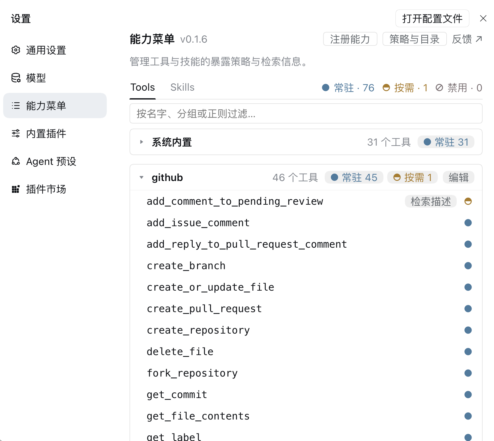
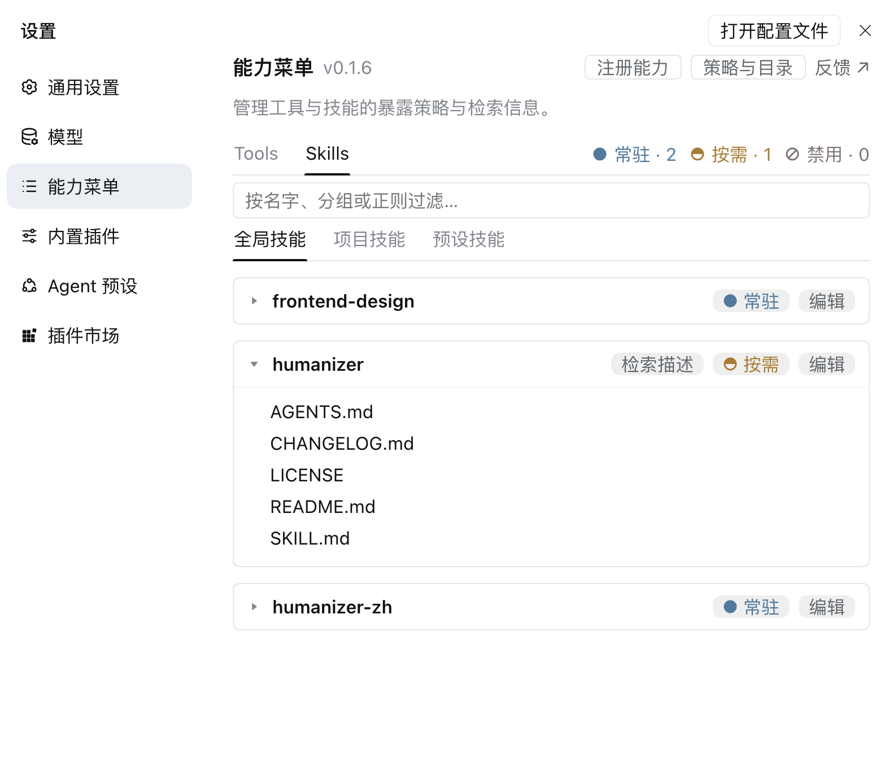

<h1 align="center">dsh-capability-menu</h1>

<p align="center">
  <strong>统一管理 DeepSeek Harness 工具与技能，高效检索、按需调用，节省上下文</strong>
</p>

<p align="center">
  <a href="https://github.com/deepseek-ai/deepseek-harness"></a>
  <a href="https://www.npmjs.com/package/@daweifu/capability-menu"></a>
  <a href="https://github.com/PKUfudawei/dsh-capability-menu/actions"></a>
  <a href="https://www.npmjs.com/package/@daweifu/capability-menu"></a>
  <a href="https://github.com/PKUfudawei/dsh-capability-menu"></a>
  <a href="https://github.com/awesome-dsh-plugin/awesome-dsh-plugin"></a>
</p>

<p align="center">
  <strong>简体中文</strong> · <a href="./README.en.md">English</a>
</p>

## 目录

- [能力总览](#能力总览)
  - [能力模型](#能力模型)
  - [能力菜单](#能力菜单)
- [安装与卸载](#安装与卸载)
  - [从 npm 安装（推荐）](#从-npm-安装推荐)
  - [从源码安装](#从源码安装)
  - [验证安装](#验证安装)
  - [卸载](#卸载)
- [暴露策略](#暴露策略)
  - [Tools 和 Skills 三档暴露与执行对照](#tools-和-skills-三档暴露与执行对照)
- [配置](#配置)
  - [按需能力检索目录（`catalogFile`）](#按需能力检索目录catalogfile)

---

## 能力总览

- 为 DeepSeek Harness 的 tools（包括 MCP 工具和内置工具）与 skills 建立统一能力目录：`ctx.capability`。
- 提供**常驻 / 按需 / 禁用**三档策略，管理能力的暴露与调用。
- 按需能力只在需要时提供给 Agent，减少单次请求携带的工具定义，节省 token 和上下文。

### 能力模型

Capability 是本插件引入的上位概念：Tool / Skill 是不同类型的 capability。

| kind | 对 Agent 提供 | action | 备注 |
| --- | --- | --- | --- |
| `tool` | 执行一个动作（MCP 工具或内置原生工具） | `execute` | 由 `ctx.tools` 索引 |
| `skill` | 某类任务的方法/流程/知识 | `load` | 由 `ctx.skills` 索引 |

模型获得两个元工具：

| 工具 | 作用 | 对应 entry |
| --- | --- | --- |
| `meta_search` | 在当前会话可见能力中搜索；列表支持 offset 分页并返回总数、已返回数和是否还有下一页；详情返回说明及工具参数 schema | `@daweifu/capability-menu/search` |
| `meta_invoke` | 统一执行面：Tool 真执行（走完整 `ctx.tools` 管线）+ Skill 加载；`force: true` 可重载已更新的 Skill | `@daweifu/capability-menu/invoke` |

### 能力菜单

<p align="center">
  
  
</p>

安装后，在「设置」导航中选择「能力菜单」，即可管理 Tools 和 Skills。

| 操作 | 用法 |
| --- | --- |
| 更改档位 | 点击能力旁的圆点；也可以点击顶部档位计数，批量切换该组能力 |
| 查找能力 | 使用页签下方的过滤框搜索名称或分组；支持正则表达式，不区分大小写 |
| 查看能力详情 | 点击 Tool 查看定义；点击 Skill 展开文件列表并预览文件，内容按 Markdown 渲染 |
| 注册能力 | 点击右上角「注册能力」，添加 MCP 服务器或 Skill 目录；Skill 支持本机目录或公开 GitHub 链接 |
| 编辑或移除 | 在 Tools 的服务器分组或 Skills 的技能项中点击「编辑」 |
| 查看规则和检索目录 | 点击页头右侧的「策略与目录」，查看生效规则及自动生成的按需能力检索目录；可在目录页调整检索描述上限 |
| 编辑检索描述 | 将 Tool 或 Skill 设为「按需」后，点击旁边的「检索描述」，在来源描述的简短版本上修改 |

备注：

- **MCP 名称**：分组内省略 `mcp__服务器名__` 前缀；悬停可看全名，检索和调用仍用完整 ID。
- **注册位置**：MCP 写入 patch 配置（自动创建缺失的文件和目录）；请求头等凭据也保存在其中，请妥善保管。Skill 在所选技能根目录创建链接或导入目录。
- **GitHub Skill**：支持公开仓库的默认分支根目录（含 `SKILL.md`）、指定分支根目录 `.../tree/{branch}` 或其下的技能目录 `.../tree/{branch}/{skill-directory}`；也支持本机目录。导入需在运行 dsh 的机器上安装 Git；插件会校验 `SKILL.md`，只复制所选目录。

## 安装与卸载

前置：[Node.js](https://nodejs.org/en/download) 与 [dsh CLI](https://github.com/deepseek-ai/deepseek-harness)。从 npm 安装无需单独安装 pnpm；从源码安装需要 pnpm。

兼容性：已在 DSH `0.2.0-rc.2` 和 `0.2.1-rc.2` 上通过测试；当前开发与构建依赖使用 `0.2.1-rc.2`。

### 从 npm 安装（推荐）

```sh
dsh plugin --profile web add @daweifu/capability-menu
```

### 从源码安装

```sh
git clone https://github.com/PKUfudawei/dsh-capability-menu.git
cd dsh-capability-menu
pnpm install

dsh plugin --profile web add .
```

### 验证安装

```sh
cd "${DSH_HOME:-$HOME/.dsh}/profiles/web" && pnpm list @daweifu/capability-menu && dsh --profile web --dump-config | grep -m1 '== @daweifu/capability-menu'
```

### 卸载

```sh
dsh plugin --profile web remove @daweifu/capability-menu
```

## 暴露策略

所有能力（Tool 与 Skill）按 **暴露程度**（模型在上下文中看到什么）与 **执行方式** 分为三档：

### Tools 和 Skills 三档暴露与执行对照

| 档位 | 能力 | 模型能看到什么 | 如何找到 | 如何使用 |
| --- | --- | --- | --- | --- |
| **常驻** | tool | 工具定义始终随请求提供 | 无需查找 | 直接调用；运行时经过完整 `ctx.tools` 管线 |
| | skill | 名称和简介显示在 `<available_skills>` 中 | 无需查找 | `skill` 工具按需加载正文 |
| **按需** | tool | 不随请求提供工具定义 | 用 `meta_search` 搜索候选项，或搜索能力目录 YAML（`catalogFile`） | 按精确 ID 查看参数后，用 `meta_invoke` 调用 |
| | skill | 不显示在 `<available_skills>` 中 | 用 `meta_search` 搜索，或搜索能力目录 YAML（`catalogFile`） | 用 `meta_invoke` 加载 `SKILL.md` |
| **禁用** | tool | 不随请求提供工具定义 | 搜索结果和能力目录中均不可见 | 调用会被拒绝 |
| | skill | 不显示在 `<available_skills>` 中 | 搜索结果和能力目录中均不可见 | 加载会被拒绝 |

适用范围与例外：

- MCP 工具和可编目的 DSH 原生工具都支持三档；原生工具归入 `built-in` 分组。请勿将 MCP 服务器命名为 `built-in`，以免与该分组冲突。
- `meta_search` 和 `meta_invoke` 默认常驻，不能在菜单中禁用。DSH Code Mode 的入口 `run_code` 不进入本插件的目录或菜单；手写通配规则仍可能匹配它，请勿将其设为按需或禁用。
- 高频工具建议保持常驻；按需工具可通过 `meta_search` 找 ID、查看参数 schema，再调用。

## 配置

手写规则位于 `capability-menu-policy` entry 的 `config` 下。以下是配置片段；完整安装补丁见 [cordis.patch.yml](./cordis.patch.yml)。

- 默认 patch 是 `${DSH_HOME:-~/.dsh}/cordis.patch.yml`；Profile 也可在自己的 patch 中覆盖该 entry。
- 菜单中的档位调整立即生效，停手约 1.5 秒后写入独立的 `stateFile`，不会因档位写入而重载插件。手写规则仍是基础；界面选择覆盖同一能力的精确规则，禁用通配规则仍优先。
- `stateFile` 默认与 `patchFile` 同目录，各 Profile 共用；需要隔离时，分别指定 `stateFile`。要清除界面选择，停止 DSH 后删除该状态文件；原有 patch 规则仍会生效。

```yaml
config:
  tools:
    on-demand: # 按需
      - 'mcp__example__*'    # 某个 MCP 服务器下的工具
    disabled: # 禁用
      - 'mcp__secret__*'
  skills:
    on-demand: # 按需
      - example_skill        # 未列出的能力默认常驻
```

通常只需设置 `tools` 和 `skills`。文件路径与防抖等可选项使用默认值即可；完整参数见 [policy 配置](./src/policy.ts) 和 [registry 配置](./src/registry.ts)。

**规则优先级**（按序匹配：禁用始终优先；在常驻与按需之间，精确规则优先于通配）：

| 优先级 | 规则 | 示例 | 效果 |
| --- | --- | --- | --- |
| 1 | `disabled` 精确 | `disabled: [forbidden_skill]` | 最硬禁用，压过一切 |
| 2 | `disabled` 通配 | `disabled: ['mcp__secret__*']` | 整组禁用 |
| 3 | `resident` 精确 | `resident: [bash]` | 单个能力显式常驻 |
| 4 | `on-demand` 精确 | `on-demand: [example_skill]` | 单个能力显式按需（能力菜单点击写入的就是这类） |
| 5 | `resident` 通配 | `resident: ['mcp__gongfeng__*']` | 整组常驻 |
| 6 | `on-demand` 通配 | `on-demand: ['mcp__*']` | 兜底批量按需 |
| 默认 | 未命中任何规则 | — | 常驻 |

若更高优先级规则覆盖了所选档位，界面会提示「分类未生效」。

### 按需能力检索目录（`catalogFile`）

插件将按需 Tool 和 Skill 写入 YAML 检索目录；常驻与禁用能力不写入。

- **目录文件：** 默认为 `${DSH_HOME:-~/.dsh}/capability-catalog.yaml`；无按需能力时内容是 `capabilities: []`。设置 `catalogFile: ''` 可关闭生成。目录随能力、档位和检索描述变化自动更新，请勿直接编辑生成文件。
- **检索描述：** 按需能力旁可打开编辑框。它预填最多 `summaryMaxChars` 个字符的来源描述（默认 320，截断时优先保留完整词句）；修改后用于 `meta_search` 列表与关键词匹配，并同步到目录，不改变来源定义或精确详情。「还原」仅重置输入框，仍需「保存」。
- **描述上限：** 在「策略与目录 → 按需能力检索目录」修改，最小 20 字符。设置保存在 `searchMetadataFile`，优先于 patch 中的 `summaryMaxChars`；降低上限前需先缩短超限的自定义描述。
- **检索与调用：** 使用 `meta_search({query})` 或目录中的 `id` 查找候选项，再用 `meta_search({id, kind})` 查看完整参数 schema，最后用 `meta_invoke({id, kind, args})` 调用或加载。目录只保存检索摘要，不包含参数 schema。模型能读取目录路径时，也可用 `grep` / `read` 检索。`meta_search` 默认每页 20 项、最多 50 项；下一页的 `offset` 等于当前 `offset + returned`。Skill 须先注册到 `ctx.skills`；若要重新加载会话中已读取的 Skill，传 `force: true`。

生成文件示例：

```yaml
capabilities:
  - id: mcp__km__search
    kind: tool
    description: 搜索知识库
    server: km
  - id: example_skill
    kind: skill
    description: 处理日志的低频技能
    whenToUse: 排查日志问题时使用
```

## License

本项目遵循 [Apache License 2.0](LICENSE)。
